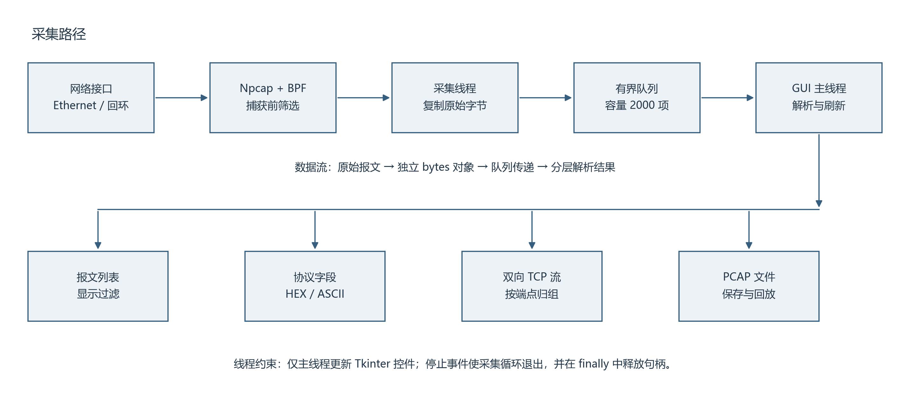
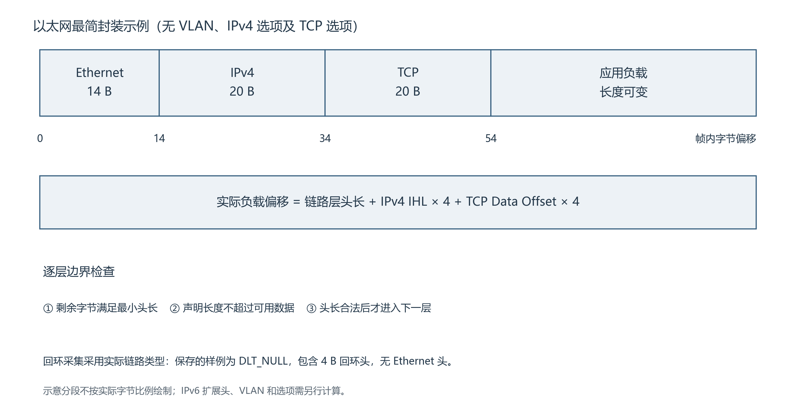
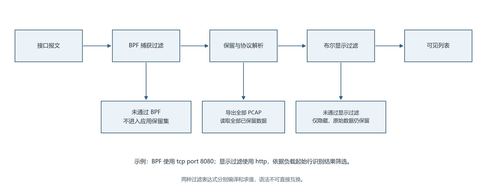
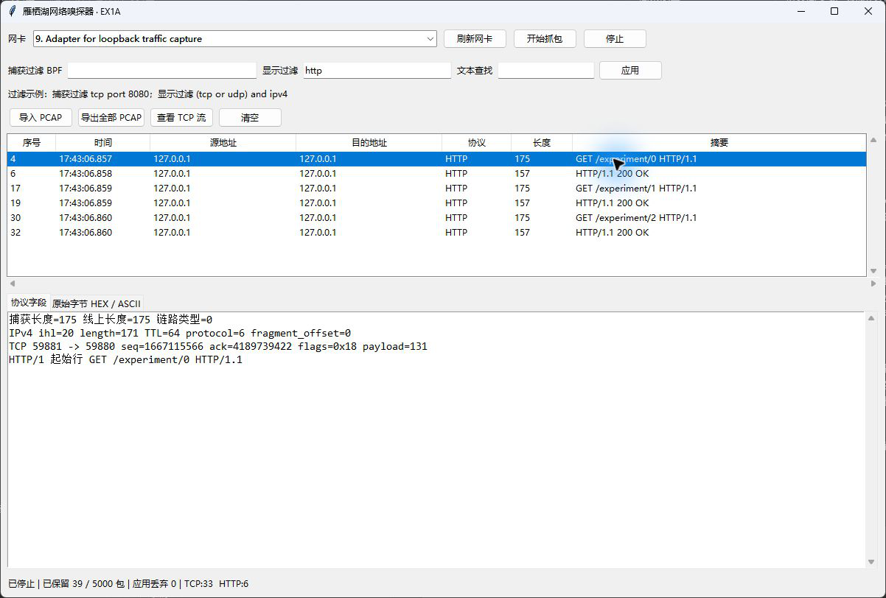
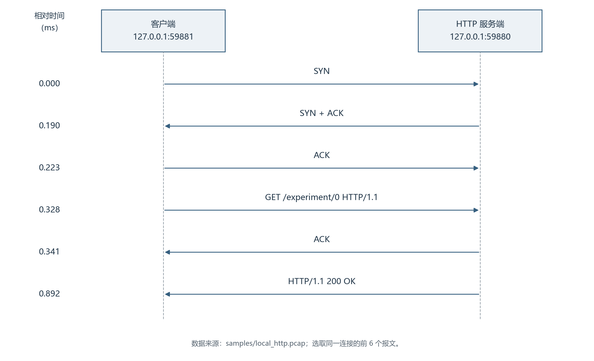
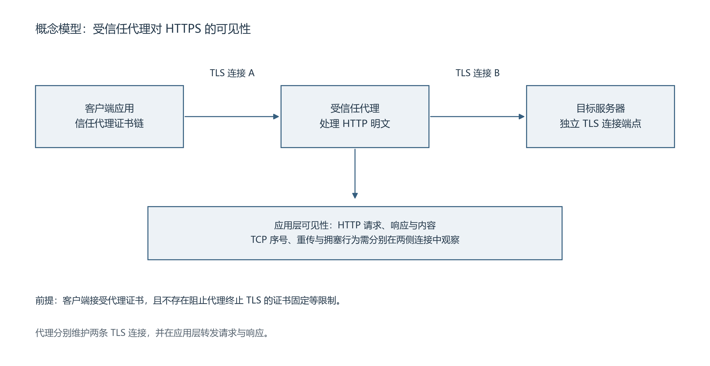

# 基于 Npcap 的图形化网络嗅探器设计与实现

**软件与安全 · 实验 1A：网络嗅探器**

课程：软件与系统安全  
姓名：万梓桐  
学号：202628015029010  
培养单位：中国科学院软件研究所  
源码仓库：[ZitongWan/NPS](https://github.com/ZitongWan/NPS)

## 摘要

网络报文的捕获位置、协议封装结构与应用层识别能力共同决定流量分析结果的可解释性。面向 Windows 环境，采用 Npcap、Python 标准库及 Tkinter 构建图形化网络嗅探器，形成报文采集、分层解析、两级过滤、双向 TCP 报文追踪与 PCAP 保存回放的处理流程。采集线程通过有界队列向界面主线程传递原始字节，协议解析器通过头部长度与声明长度检查限制解析范围。31 项自动测试全部通过；两次受控回环 HTTP 实验分别捕获 39 和 40 个报文，均识别出 6 个 HTTP 请求或响应报文。结果表明，在所列用例与回环实验条件下，报文采集、解析、过滤及回放流程符合预期。

**关键词：** 网络嗅探；Npcap；协议解析；BPF；TCP 流；图形用户界面

## 1 实验目标与理论基础

实验 1A 要求实现网络报文捕获，并通过图形界面查看协议字段、筛选报文和追踪 TCP 通信[1]。各项功能的实现见表 1。测试采用本机 HTTP 服务生成受控流量，并按请求次数核对捕获结果。

**表 1　功能需求与实现对应关系**

| 功能要求 | 实现方式 |
| --- | --- |
| 实时抓包（NPS） | capture.py 调用 Npcap，采集接口上的原始报文 |
| 图形界面（GUI） | app.py 提供网卡选择、报文列表、协议字段及原始字节视图 |
| 协议过滤 | 支持 HTTP、TCP/UDP、IPv4/IPv6、ICMP 等协议及逻辑组合；另设 BPF 捕获过滤 |
| 协议分析（NPA） | 分层解析链路、网络和传输层字段，识别 HTTP 起始行与 DNS 头部 |
| 双向 TCP 流追踪 | 按 IP 与端口归组，显示时间、序号、确认号、标志和负载 |
| Npcap 接口调用 | 通过 ctypes 加载动态链接库并管理采集句柄 |

### 1.1 课程知识与实现依据

网卡选择、BPF 过滤和 Npcap 调用参照网络监听课件[2]。捕获的 HTTP 明文直接暴露请求内容，体现了课程中讨论的明文传输风险[3]。TCP 的 SYN、ACK、FIN 等标志用于判断连接建立、确认和关闭过程[4]。

### 1.2 协议层次与可观察信息

**表 2　协议层次与可观察字段**

| 层次 | 可展示的信息 |
| --- | --- |
| 物理层 | 不涉及电压、光信号及无线调制参数的测量 |
| 数据链路层 | Ethernet 源/目的 MAC、EtherType、VLAN；回环接口可能没有以太网头 |
| 网络层 | IPv4/IPv6 地址、TTL/Hop Limit、分片提示；ICMP 类型与代码 |
| 传输层 | TCP/UDP 端口，TCP seq/ack/flags |
| 会话、表示与应用层 | TCP/IP 实现不严格对应三个独立层次；展示 HTTP/1 起始行、DNS 头部及 TLS 记录特征 |

## 2 系统架构与报文采集

程序运行在 Windows 上，界面使用 Tkinter，抓包模块通过 ctypes 调用 Npcap。Python 端仅依赖标准库，实时抓包需另行安装 Npcap。测试使用的解释器为 64 位 Python 3.8.20 和 Python 3.11.7。

**表 3　软件模块与职责划分**

| 模块 | 职责 |
| --- | --- |
| capture.py | 枚举网卡、创建抓包句柄、编译/设置 BPF、读取原始帧、关闭句柄 |
| protocol.py | 边界检查、协议解析、布尔过滤、PCAP 读写、双向流归组 |
| app.py | GUI、捕获线程、有界队列、批量更新、文件操作 |
| test_protocol.py | 19 项基础测试，检查协议解析、过滤和 PCAP 读写 |
| test_regressions.py | 12 项回归测试，检查文件保护、流显示、界面状态及输出目录保护 |
| local_validation.py | 生成三次本地 HTTP 请求，保存真实抓包与环境记录 |

### 2.1 线程协作



**图 1　系统架构与线程数据流。** 采集线程通过有界队列传递报文，主线程负责解析和界面更新。

采集线程读取报文后，按 caplen 指定的长度复制字节并放入队列，防止后续读取覆盖缓冲区而影响已采集数据。主线程从队列取出报文，完成解析和界面更新，每轮最多处理 150 条，约 100 ms 后继续处理下一批。协议计数随新报文到达逐次累加，避免在每次界面刷新时重复统计。

### 2.2 采集接口与生命周期

Npcap 的主要调用顺序如下[5]：

1. `pcap_findalldevs`：枚举接口，复制名称与说明后释放接口链表。
2. `pcap_open_live`：设置 snaplen=65535、非混杂模式和 100 ms 读取超时。
3. `pcap_datalink`：识别链路封装；`pcap_compile → pcap_setfilter → pcap_freecode`：设置 BPF。
4. `pcap_setnonblock → pcap_next_ex`：非阻塞读取；返回 1、0、−1、−2 分别表示获取报文、暂无数据、错误和读取结束。暂无数据时等待 10 ms。
5. 在 `finally` 中调用 `pcap_close`，释放句柄。

### 2.3 资源约束与文件保护

队列容量为 2000，报文保留上限为 5000；达到上限即请求停止，队列溢出及超额数据计入应用丢弃数量。该计数不包含驱动丢包。按最大捕获长度估算，5000 份原始字节约占 312.5 MiB，实际内存还包括队列、解析对象和控件。

导出 PCAP 时，先写临时文件，写入成功后再替换目标文件，以免保存失败损坏已有记录。时间戳按微秒舍入，并处理跨秒进位。导入时先检查过滤条件并读完整个文件，再替换当前列表；重新筛选后清空旧报文详情。驱动加载、BPF 编译或文件读写失败时，界面显示错误信息。

## 3 协议解析方法

### 3.1 分层解析与长度约束

解析从链路层开始，根据协议类型逐层读取网络层和传输层字段。每次读取前检查剩余字节数，多字节网络字段按大端字节序解码。IPv4、IPv6 和 UDP 还需检查报文中声明的长度，避免将填充字节纳入解析或越过已捕获数据的范围。格式异常的报文标记为 `MALFORMED`，原始字节仍然保留。

**表 4　协议解析范围及边界条件**

| 协议 | 解析字段与边界 |
| --- | --- |
| Ethernet / VLAN | 14 字节 Ethernet 头；检查 EtherType；最多解析 4 层 VLAN 标签 |
| ARP | 检查硬件/协议地址长度；识别操作码；IPv4 ARP 显示双方协议地址 |
| IPv4 | 版本、IHL、总长度、TTL、协议号、地址及分片信息；IHL ≥ 5，头部至少 20 字节 |
| IPv6 | 40 字节基本头，地址与 Hop Limit；有限遍历常见扩展头 |
| TCP | 源/目的端口、seq、ack、data offset、flags；最短 20 字节 |
| UDP | 端口与长度；最短 8 字节；按 UDP 长度截取负载 |
| ICMP / ICMPv6 | 类型及代码；网络层协议编号分别为 1 和 58 |
| HTTP / DNS / TLS | HTTP/1 起始行模式匹配；DNS 基于端口和头部启发式识别；TLS 仅匹配记录头特征 |

### 3.2 字段偏移与封装核对

表 5 的偏移以各协议头起点为零；实际位置由链路类型和前一层头长确定。

**表 5　关键字段与偏移计算**

| 协议 | 字节偏移 | 字段 | 解析用途 |
| --- | --- | --- | --- |
| Ethernet | 0–5 / 6–11 / 12–13 | 目的 MAC / 源 MAC / EtherType | 确定链路层地址及下一层类型 |
| IPv4 | 0 的低 4 位 | IHL | 头部长度 = IHL × 4，包含可选字段长度 |
| IPv4 | 2–3 / 6–7 / 9 | 总长度 / 标志与片偏移 / 协议号 | 限定解析范围，检查分片，选择上层解析器 |
| IPv6 | 4–5 / 6 / 7 | Payload Length / Next Header / Hop Limit | 检查负载，遍历受支持的扩展头 |
| TCP | 0–1 / 2–3 / 4–7 / 8–11 | 源端口 / 目的端口 / seq / ack | 显示端点与序号信息 |
| TCP | 12 的高 4 位 / 13 | Data Offset / 控制标志 | TCP 头长 = Data Offset × 4，定位应用负载 |
| UDP | 0–1 / 2–3 / 4–5 | 源端口 / 目的端口 / UDP 长度 | 最小长度为 8，检查后截取负载 |



**图 2　报文封装与字段偏移。** 帧内偏移 14、34、54 适用于无 VLAN、无 IP/TCP 选项的以太网报文。

回环样例采用 4 字节 DLT_NULL 头。选中 GET 报文的捕获长度为 175 字节，即 4 字节回环头、20 字节 IPv4 头、20 字节 TCP 头与 131 字节负载；其中 IPv4 总长度为 171 字节，与界面解析结果一致。

### 3.3 应用层识别

HTTP 识别检查 TCP 负载是否以 HTTP/1 请求行或状态行开头。测试结果表明，程序识别出 8080 端口上的 HTTP 报文，且未将 80 端口上的普通数据误判为 HTTP。由于解析针对单个 TCP 段，起始行被拆分到多个段时无法识别，也不支持 HTTP/2 和 HTTP/3。

DNS 结合端口和头部特征判断，尚未解析压缩域名。`TLS?` 表示负载符合 TLS 记录头特征，不代表已经解密其中的内容。

### 3.4 分片与截断处理

IPv4 的 MF 标志为 1 或片偏移非零，以及 IPv6 出现 Fragment 扩展头时，均标记分片并停止传输层解析。当前不进行 IP 重组，也未实现 IPv6 Jumbo Payload、ESP 解密及校验和验证。捕获长度与线上长度分别表示已保存字节数和接口报告的原始长度，两者的差异用于辅助判断采集截断。

## 4 过滤机制与 TCP 流分析

### 4.1 两级过滤

BPF 在报文进入程序前进行筛选[5-6]，显示过滤则作用于已经保存的报文。因此，输入 `http` 只会隐藏不匹配的列表行，导出全部 PCAP 时仍会保存这些报文。两种过滤的位置和常用表达式见图 3、表 6。



**图 3　捕获过滤与显示过滤的数据路径。** 两级过滤分别作用于采集入口和显示列表。

**表 6　捕获过滤与显示过滤示例**

| 目的 | BPF 捕获过滤示例 | 显示过滤示例 |
| --- | --- | --- |
| TCP | tcp | tcp |
| IPv4 上的 TCP/UDP | ip and (tcp or udp) | ipv4 and (tcp or udp) |
| 本地 HTTP 测试端口 | tcp port 8080 and host 127.0.0.1 | http |
| ICMP 与 ICMPv6 | icmp or icmp6 | icmp or icmpv6 |
| 排除 TCP | not tcp | not tcp |

以 8080 端口上的 HTTP 通信为例，BPF 设置为 `tcp port 8080`，再通过显示过滤 `http` 筛选请求与响应。BPF 不提供通用的 `http` 关键字；遇到分片、扩展头或格式异常时，两级过滤的结果可能不同。

显示过滤使用 Python 抽象语法树（AST）解析，仅允许协议名称、`and`、`or`、`not` 和括号，不调用 `eval`；表达式限制为 512 字符、128 个 AST 节点。文本查找匹配地址和摘要，忽略大小写。点击“应用”后，已有报文与新到报文使用相同条件。

### 4.2 双向端点归组

将端点表示为 `e = (IP, port)`，归组键定义为 `K = sort(e_src, e_dst)`，使正反向报文进入同一组。流窗口按捕获顺序显示本地时间、相对首包时间、方向、seq、ack 和控制标志；IPv6 地址用方括号分隔端口。每段最多预览 4096 字节，超出时标明数量，完整数据仍保留在 PCAP 中。

例如，`127.0.0.1:59881 → 127.0.0.1:59880` 与反向报文共享归组键，对应第 5.2 节的实测连接。

### 4.3 分析范围

同一对 IP 和端口被再次使用时，新连接可能被归入旧的报文组。流窗口也未处理重传、乱序、缺段和序号回绕，因此目前只能按捕获顺序查看报文，不能还原完整的 TCP 字节流。程序尚未将连接与操作系统中的 PID 关联。

## 5 实验设计与结果分析

### 5.1 环境与验证结果

测试系统为 Windows，内核版本 10.0.26200。先启动本机 HTTP 服务，再通过 Npcap 回环接口捕获三次请求产生的流量。测试使用 Python 3.11.7 和本地 Conda 环境 `stage4`（Python 3.8.20），两者均为 64 位，结果见表 7。

**表 7　实验验证结果**

| 验证项目 | 验证结果 |
| --- | --- |
| 基础测试 | 19 项全部通过：协议与封装 7 项、异常与分片 5 项、过滤 4 项、PCAP 读写 2 项、双向归组 1 项 |
| 回归测试 | 12 项全部通过：PCAP 保护与兼容性 5 项、流显示 2 项、界面状态 4 项、目录保护 1 项 |
| 异常输入 | 对 HTTP 样例逐字节截断，并输入 1000 份固定种子随机报文，未发生未处理异常 |
| 回环采集 | 39 个报文；6 个 HTTP 请求/响应报文；端口 59880 |
| 重复采集 | 40 个报文；6 个 HTTP 请求/响应报文；端口 53030 |
| `stage4` 环境兼容验证 | Python 3.8.20 下 31 项测试通过；捕获 41 个报文，其中 HTTP 6 包；端口 49941 |
| BPF 范围 | 捕获报文的源、目的地址均为 127.0.0.1，至少一端端口为测试服务端口 |
| 停止与资源 | 停止后采集线程正常结束，句柄在 finally 中关闭 |
| GUI 操作 | 检查记录覆盖 6 条 HTTP 结果、状态栏、滚动条与搜索条件一致性 |
| 尚未测量 | 持续高负载、驱动丢包率、不同 Windows 版本、复杂 IPv6 扩展链 |

31 项按测试方法计数，逐字节截断和 1000 份随机输入合计为其中一项。界面状态测试使用模拟控件检查导入、筛选和清空操作；回环测试调用 Npcap，核对请求与响应的捕获结果及采集线程的退出状态。

重新运行 `local_validation.py` 时，新生成的 PCAP 文件和验证信息默认写入 `validation_output/`，不会覆盖 `samples/` 中随源码附带的实验记录。

三轮实验分别捕获 39、40 和 41 个报文，均包含 3 个 HTTP 请求和 3 个响应。总包数不完全相同，但请求与响应数量一致，BPF 范围和停止检查均通过。



**图 4　回环 HTTP 报文的离线分析界面。** 导入 `local_http.pcap` 后，按 HTTP 筛选并查看字段。

图 4 的状态栏显示 `TCP:33` 和 `HTTP:6`，合计 39 包。HTTP 报文同样包含 TCP 头，界面统计将其单独归类为 HTTP。按两端地址和端口归组后得到 3 组，对应三次请求使用的连接。

### 5.2 真实连接的报文时序

图 5 和表 8 展示一条回环 TCP 连接的前六个报文，相对时间从首包开始计算。再次运行时，临时端口和初始序号会变化。



**图 5　一次回环 TCP 连接的前 6 个报文。** 依次展示握手、HTTP 请求、服务端确认和响应头。

**表 8　真实连接前六个报文的字段记录**

| 相对首包时间（ms） | 方向（端口） | 协议 | 观察结果 |
| --- | --- | --- | --- |
| 0.000 | 59881 → 59880 | TCP | flags=0x02，seq=1667115565 |
| 0.190 | 59880 → 59881 | TCP | flags=0x12，seq=4189739421 |
| 0.223 | 59881 → 59880 | TCP | flags=0x10，seq=1667115566 |
| 0.328 | 59881 → 59880 | HTTP | GET /experiment/0 HTTP/1.1 |
| 0.341 | 59880 → 59881 | TCP | flags=0x10，seq=4189739422 |
| 0.892 | 59880 → 59881 | HTTP | HTTP/1.1 200 OK |

前三包分别带有 SYN、SYN+ACK 和 ACK 标志，完成三次握手。客户端初始序号为 `1667115565`，服务端确认号为 `1667115566`，增加的 1 对应 SYN 占用的一个序号。GET 请求携带 131 字节负载，服务端随后确认到 `1667115697`，等于 `1667115566 + 131`。该 ACK 先于 HTTP 响应出现，说明 TCP 接收确认并不等同于应用层已发送响应。

### 5.3 数据记录与覆盖范围

表 9 列出随源码附带的测试输出、抓包文件和验证记录，统一保存在 `samples/` 文件夹中，供核对实验结果和离线回放使用。

**表 9　测试记录与数据文件**

| 文件名 | 记录内容 |
| --- | --- |
| test_results.txt | 原始 19 项基础测试输出 |
| test_results_20261119.txt | Python 3.11.7 环境中 31 项测试输出 |
| validation.json | 原始采集的接口、端口、数量及停止检查 |
| local_http.pcap | 回环 HTTP 通信的 39 包记录 |
| revalidation_20261119.pcap | 复测的 40 包记录 |
| revalidation_20261119.json | 复测环境及验证结果 |
| test_results_stage4_20261119.txt | 本地 Conda 环境 `stage4` 中的 31 项测试输出 |
| stage4_validation_20261119.pcap | 本地 Conda 环境 `stage4` 中的 41 包记录 |
| stage4_validation_20261119.json | 本地 Conda 环境 `stage4` 的环境信息及验证结果 |
| gui_checks.json | HTTP 筛选、状态栏、滚动条与搜索一致性检查 |

测试文件包含非法长度、复杂过滤表达式、PCAP 字节序与时间精度、保存失败、导入失败和流显示等用例。真实抓包仅测试了 IPv4 回环 HTTP，其他协议主要使用构造报文，尚未与独立协议分析器逐字段比对，也未进行持续负载测试。

## 6 讨论与原理分析

### 6.1 HTTPS 代理的明文可见性

课程中的 Thor 思考题[1]涉及 HTTPS 明文解析的信任条件与协议层次差异。以受信任 HTTPS 代理为例，在客户端信任代理证书且不存在证书固定等限制时，代理分别与客户端、服务器建立 TLS 连接，在接收端解密数据、在发送端重新加密，从而访问中间的 HTTP 明文。安装代理根证书的作用是使客户端信任该根证书签发的代理证书。



**图 6　受信任 HTTPS 代理的可见性模型。** 代理终止两侧 TLS 连接；被动嗅探器不参与该过程。

在上述代理模型中，客户端至代理、代理至服务器分别使用独立的 TCP 连接。HTTP 明文反映应用层交互内容，而两侧连接的序号、确认号和重传行为仍需依据相应链路上的抓包记录进行分析。

### 6.2 NPS 与 NPA 的区别

NPS 负责从网络接口捕获报文，NPA 负责解析协议字段及通信过程。代码中，`capture.py` 负责获取原始字节，`protocol.py` 负责识别协议和读取字段。采集与解析分离后，同一解析器用于处理实时流量和 PCAP 离线报文。

### 6.3 混杂模式的可见范围

混杂模式仅改变网卡对已到达帧的接收方式。交换机未向当前接口转发其他主机的单播帧时，启用混杂模式也无法捕获这些帧。测试仅采集本机通信，程序默认不启用混杂模式。

### 6.4 捕获开销与性能评价

报文处理包括字节复制、字段解析和列表更新。BPF 通过入口过滤减少进入程序的报文量，批量刷新减少界面更新次数；这些措施的性能收益仍需通过吞吐量和丢包测试评估。当前未调用 `pcap_stats`，状态栏仅统计应用层丢弃数量，不能据此计算驱动丢包率。

### 6.5 HTTP 与 HTTPS 的可分析信息

HTTP 的请求行、头部和正文以明文传输，捕获报文包含相应的明文数据。HTTPS 的应用数据经过 TLS 加密；缺少会话密钥或 TLS 终止端点提供的解密信息时，分析范围限于地址、端口、长度、时间和部分握手字段。程序未实现 TLS 解密。

## 7 结论

嗅探器完成了 Npcap 实时采集、分层解析、报文筛选和 PCAP 保存回放，31 项自动测试全部通过。回环实验记录了 TCP 握手、HTTP 请求与响应，并通过负载长度核对了序号和确认号的变化。双向流目前按端点归组，后续仍需处理连接复用、重传和乱序。

## 参考文献

[1] 刘鹏. 实验 1 讲解 2026: 课程实验材料[Z]. 中国科学院大学, 2026.

[2] 张玉清. 第 3 章 网络监听及防御技术: 课程课件[Z]. 2026.

[3] 张玉清. 第一章 网络安全概述: 课程课件[Z]. 2026.

[4] 张玉清. 第 2 章 扫描与防御技术: 课程课件[Z]. 2026.

[5] Npcap. [pcap: Packet Capture library](https://npcap.com/guide/wpcap/pcap.html)[EB/OL].

[6] Npcap. [pcap-filter: packet filter syntax](https://npcap.com/guide/wpcap/pcap-filter.html)[EB/OL].

## 附录 A 运行与复现

### A.1 环境与自动验证

安装带 Tkinter 的 64 位 Python 及 Npcap，进入源码目录。以下命令使用本地 Conda 环境 `stage4`（Python 3.8.20）；在其他环境中运行时，按其配置调整或省略激活命令。若 Npcap 限制捕获权限，使用管理员终端。

```powershell
conda activate stage4
python -m unittest -v
python local_validation.py
```

第一条 Python 命令执行自动测试，第二条进行独立回环抓包验证。离线分析时，运行 `python app.py`，导入 `samples/local_http.pcap`。

### A.2 手动演示

打开三个 PowerShell 终端，例如 PyCharm 内置终端。使用本地 Conda 环境 `stage4` 时，各终端先执行 `conda activate stage4`，前两个终端位于源码目录：

1. 终端一启动界面：`python app.py`。
2. 终端二启动本地服务：

   ```powershell
   python -m http.server 8080 --bind 127.0.0.1 --directory samples
   ```

3. 界面选择回环接口，BPF 填 `tcp port 8080 and host 127.0.0.1`，开始抓包。
4. 终端三执行以下命令三次，正常响应显示 `HTTP status: 200`：

   ```powershell
   $url = "http://127.0.0.1:8080/test_results_20261119.txt"
   $curl = "C:\Windows\System32\curl.exe"
   & $curl --noproxy "*" -sS -o NUL -w "HTTP status: %{http_code}\n" $url
   ```

5. 停止抓包，用 `http` 筛选请求与响应，用 `tcp and ipv4` 查看握手；选中报文打开 TCP 流。
6. 导出全部 PCAP，清空后重新导入，核对数量。结束时关闭界面，在终端二按 Ctrl+C 停止服务。

手动演示与自动验证的服务程序和请求内容不同，总包数可能变化。若更换端口，须同步修改服务命令、BPF 和请求 URL。
